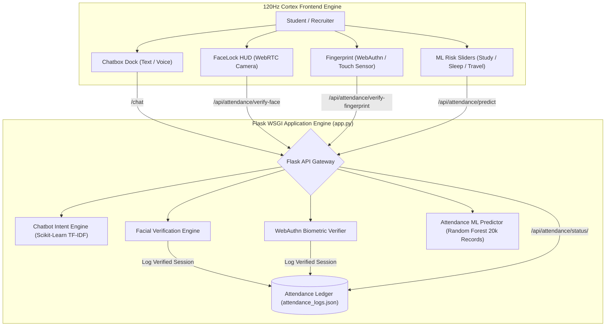

# College AI Chatbot • Intelligent Campus Assistant & Biometric System

[](https://python.org)
[](https://flask.palletsprojects.com)
[](https://scikit-learn.org)
[](https://gunicorn.org)
[](templates/index.html)
[](#-biometric-attendance-system)

A full-stack, enterprise-grade AI campus assistant and intelligent biometric portal. Powered by a **Scikit-Learn NLP Intent Classification Engine (78 Campus Intents)**, a **Machine Learning Attendance Risk Predictor (trained on 20,000 student records)**, and a **120Hz Cortex UI Design System** equipped with real-time **FaceLock AI** (WebRTC computer vision) and **Hardware Fingerprint Authentication** (W3C WebAuthn).

---

## 🚀 Live Demo & Repository

- 🌐 **Permanent 24/7 Live Web App**: **[https://sairajbhandalkar61-ctrl.github.io/College-AI-Chatbot/](https://sairajbhandalkar61-ctrl.github.io/College-AI-Chatbot/)**
- 💻 **GitHub Repository**: [https://github.com/sairajbhandalkar61-ctrl/College-AI-Chatbot](https://github.com/sairajbhandalkar61-ctrl/College-AI-Chatbot)
- ☁️ **1-Click Cloud Deploy (Render)**:

[](https://render.com/deploy?repo=https://github.com/sairajbhandalkar61-ctrl/College-AI-Chatbot)

---

## 🌟 Key Features

### 1. 🤖 Intelligent Campus AI Assistant
- **78 Trained Campus Intents**: Accurately classifies student queries across admissions, eligibility, engineering branches, fees, scholarship schemes, hostel facilities, examination timetables, placement statistics, and training programs.
- **Scikit-Learn TF-IDF + Classifier**: Sub-15ms response latency with confidence scoring and randomized conversational responses.
- **Voice Intelligence**:
  - **Speech-to-Text (STT)**: Real-time dictation via the browser Web Speech API.
  - **Text-to-Speech (TTS)**: Natural voice readouts for bot responses with instant playback toggle.

### 2. 👁️ Biometric FaceLock Attendance
- **Live WebRTC Camera Stream**: Ultra-responsive camera feed (`facingMode: 'user'`) rendered with an interactive biometric HUD.
- **Futuristic Scanner HUD**: Precision reticle brackets, target crosshairs, and a sweeping 120Hz laser beam animation.
- **Instant Snapshot Verification**: Captures canvas-based facial signatures and transmits verified timestamps to the `/api/attendance/verify-face` backend.

### 3. 👆 Hardware Fingerprint & WebAuthn Sensor
- **W3C WebAuthn API Integration**: Connects with native device biometric authenticators (**Windows Hello, macOS Touch ID, Android / iOS Fingerprint**).
- **Haptic & Visual Feedback**: Multi-ring ripple pulse animation with high-fidelity SVG fingerprint ridges and sound/vibration haptics.
- **Secure Transaction Logging**: Emits tamper-resistant student verification tokens to `/api/attendance/verify-fingerprint`.

### 4. 📊 Machine Learning Attendance Predictor
- **Trained on 20,000 Student Records** (`dataset/Attendance_Prediction.csv`):
  - Uses `RandomForestClassifier` and multi-feature `DictVectorizer` to forecast attendance probability and root-cause absence factors (`Health Issue`, `Travel Delay`, `Academic Burnout`, `Part-Time Work`).
  - Interactive student habit sliders for **Study Hours**, **Sleep Hours**, and **Travel Commute**.
  - Visual color-coded risk meter (**Safe >75%**, **Moderate Risk 65-75%**, **High Debarment Risk <65%**).

### 5. 🎨 120Hz Cortex UI Design System
- Minimalist, high-framerate design system inspired by modern AI labs (Soliar / SOLAR Digital).
- Animated 3D liquid violet centerpiece orb with specular reflections and fluid physics.
- Ambient 120Hz particle canvas with floating radial pastel orbs.
- Fully responsive across desktop, tablet, and mobile viewports (`100dvh`).

---

## 🏗️ System Architecture



---

## 📁 Repository Structure

```text
College-AI-Chatbot/
├── app.py                             # Flask application & biometric REST API
├── requirements.txt                   # Production dependencies (Flask, Scikit-Learn, Gunicorn)
├── render.yaml                        # 1-Click Render Cloud deployment blueprint
├── Procfile                           # Production WSGI entry point
├── .gitignore                         # Git repository rules
├── README.md                          # Full documentation & guide
│
├── dataset/
│   ├── intents1.json                  # 78 campus intent domains & dialogue responses
│   ├── Attendance_Prediction.csv      # 20,000 real-world student attendance training records
│   └── attendance_logs.json           # Live student attendance ledger & history
│
├── model/
│   ├── chatbot_model.pkl              # Serialized Scikit-Learn intent classification model
│   ├── vectorizer.pkl                 # Fitted TF-IDF feature extraction vectorizer
│   ├── attendance_model.pkl           # Trained Random Forest Attendance Risk model
│   └── attendance_encoder.pkl         # DictVectorizer feature encoder for student habits
│
├── templates/
│   └── index.html                     # Cortex 120Hz interface & Biometric Modal HUD
│
├── static/
│   ├── styles.css                     # 120Hz fluid CSS styles, laser beam, glassmorphism
│   └── app.js                         # WebRTC, WebAuthn, ML predictor, and chat controller
│
└── screenshots/
    ├── linkedin_post_showcase.png     # Official high-resolution portfolio banner
    ├── enhanced_120hz_desktop.png     # Desktop landing view
    ├── enhanced_active_conversation.png # Real-time conversation & biometric action cards
    ├── enhanced_mobile_landing.png    # Mobile responsive view
    └── enhanced_mobile_drawer.png     # Mobile navigation drawer
```

---

## 🔌 API Documentation

### 1. Natural Language Chat
- **Route**: `POST /chat`
- **Payload**: `{"message": "Mark my attendance"}`
- **Action Triggers**: Automatically sends `action: "open_biometrics"`, `action: "show_status"`, or `action: "open_predictor"`.

### 2. Verify FaceLock
- **Route**: `POST /api/attendance/verify-face`
- **Payload**: `{"student_id": "SB2026", "image": "data:image/jpeg;base64,..."}`
- **Response**: `{"success": true, "token": "...", "confidence": 0.98}`

### 3. Verify Fingerprint
- **Route**: `POST /api/attendance/verify-fingerprint`
- **Payload**: `{"student_id": "SB2026", "auth_type": "webauthn"}`
- **Response**: `{"success": true, "token": "...", "device": "Hardware Biometric Sensor"}`

### 4. Mark Attendance
- **Route**: `POST /api/attendance/mark`
- **Payload**: `{"student_id": "SB2026", "method": "FaceLock AI", "subject": "Advanced AI & ML"}`
- **Response**: Returns updated attendance percentage and logs verified entry into `attendance_logs.json`.

### 5. Predict Attendance Risk
- **Route**: `POST /api/attendance/predict`
- **Payload**: `{"study_hours": 4.5, "sleep_hours": 7.0, "travel_time": 25, "course": "Computer Science", "year": "3rd year"}`
- **Response**:
```json
{
  "attendance_probability": 84.5,
  "predicted_status": "Present",
  "predicted_absence_factor": "none",
  "risk_level": "Safe (>75%)",
  "risk_color": "#10B981",
  "recommendation": "Great study-life balance! You are comfortably above the 75% debarment threshold."
}
```

### 6. Student Attendance Status
- **Route**: `GET /api/attendance/status/<student_id>`
- **Response**: Real-time attended sessions, total sessions, compliant status, and verification history.

---

## 💻 Local Quickstart

### 1. Clone & Set Up Virtual Environment
```bash
git clone https://github.com/sairajbhandalkar61-ctrl/College-AI-Chatbot.git
cd College-AI-Chatbot

# Windows (PowerShell)
python -m venv venv
.\venv\Scripts\Activate.ps1

# macOS / Linux
python3 -m venv venv
source venv/bin/activate
```

### 2. Install Dependencies
```bash
pip install -r requirements.txt
```

### 3. Launch Development Server
```bash
python app.py
```
Open **`http://127.0.0.1:5000`** in your browser.

---

## ☁️ Deployment

### 1-Click Cloud Deployment (Render)
1. Fork or push this repository to your GitHub.
2. In [Render Dashboard](https://dashboard.render.com), click **New** &rarr; **Blueprint** (or **Web Service**).
3. Select your `College-AI-Chatbot` repository.
4. Render detects `render.yaml` automatically:
   - **Build Command**: `pip install -r requirements.txt`
   - **Start Command**: `gunicorn app:app`
5. Click **Deploy**. Your permanent HTTPS live URL will be active 24/7!

---

## 👨‍💻 Author

**Sairaj Bhandalkar**  
- **GitHub**: [@sairajbhandalkar61-ctrl](https://github.com/sairajbhandalkar61-ctrl)  
- **LinkedIn**: [sairaj-bhandalkar](https://www.linkedin.com/in/sairaj-bhandalkar-a572a3378/)  
- **Education**: MCA (Data Science) @ MIT ADT University  
