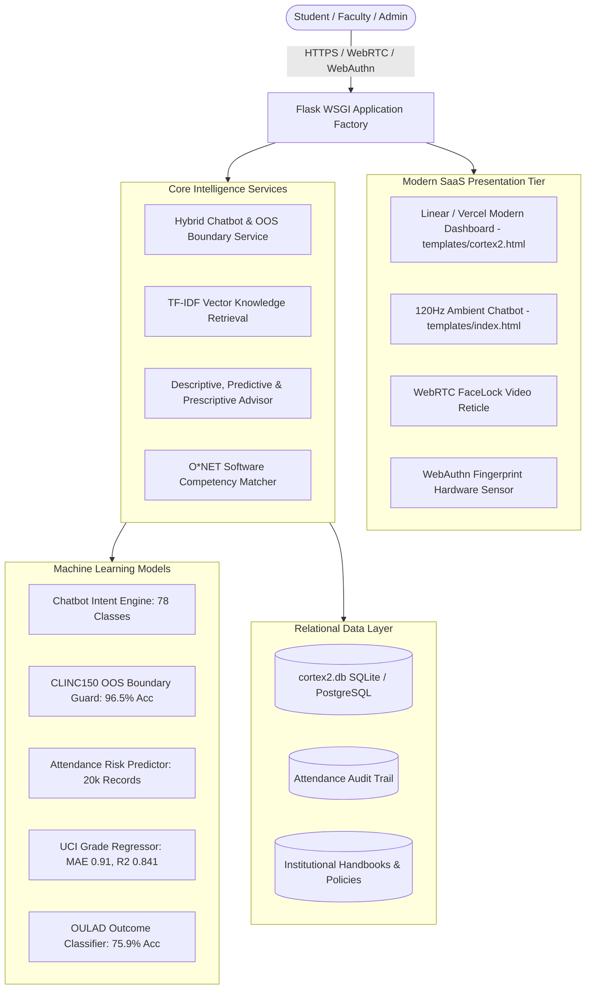

# CORTEX 2.0 • Intelligent AI Campus & Student Success Ecosystem

[](https://python.org)
[](https://flask.palletsprojects.com)
[](https://www.sqlalchemy.org/)
[](https://scikit-learn.org)
[](#-automated-testing-suite)
[](templates/cortex2.html)
[](#-multimodal-biometrics)

**CORTEX 2.0** is an enterprise-grade, full-stack campus intelligence ecosystem. It integrates **Hybrid NLP Intent Classification (78 Intents)**, **CLINC150 Out-of-Scope Boundary Detection**, **Grounded RAG Knowledge Retrieval**, **Multimodal Biometric Attendance (FaceLock AI + WebAuthn)**, and an **AI Student Success Advisor (Descriptive, Predictive, and Prescriptive Analytics)** trained on real-world educational benchmarks (UCI Student Performance, OULAD, and O*NET).

---

## 🌟 Architecture & System Topology



---

## 🚀 Key Modules & Capabilities

### 1. 🤖 AI Campus Chatbot with Guardrails & RAG
- **78 Trained Campus Intents**: Immediate responses for admissions, exam fees, hostel facilities, branch eligibility, and library hours.
- **CLINC150 Out-of-Scope (OOS) Boundary Guard**: Accurately detects and deflects queries outside institutional boundaries (banking, travel, general knowledge) to maintain academic focus.
- **Grounded Campus RAG**: Matches student inquiries against institutional handbooks with source attribution.
- **Database-Integrated Dialogue**: Directly answers queries like *"What is my attendance?"*, *"When is my next exam?"*, and *"What assignments are pending?"*.
- **Speech STT & TTS**: Web Speech API for voice dictation and natural audio response synthesis.

### 2. 👁️ Multimodal Biometric Attendance
- **FaceLock AI**: Client-side WebRTC camera frame stream with animated laser scanning reticle. Emits verifiable attendance tokens.
- **Hardware WebAuthn Fingerprint**: Direct integration with `window.PublicKeyCredential` (Windows Hello, macOS Touch ID, Android/iOS fingerprint sensors).
- **ML Habit Risk Predictor**: Evaluates study hours, sleep hours, and commute time using a 20,000-record RandomForest model to predict attendance probability.

### 3. 🎓 AI Student Success Advisor
- **Descriptive Analytics**: Real-time evaluation of attendance compliance, internal assessment scores, and composite Learning Engagement Scores ($E$).
- **Predictive Analytics**:
  - **UCI Performance Model**: Predicts final course grade ($G_3$) with a **Mean Absolute Error of 0.91** points on a 0–20 scale.
  - **OULAD Completion Model**: Predicts course pass/completion likelihood based on LMS activity clicks and assessment milestones.
- **Prescriptive Analytics & "Next Best Action"**: Identifies the single most critical learning objective the student should tackle today and provides an interactive weekly study plan checklist.

### 4. 💼 Career & Resume Guidance
- **O*NET Software Skills Taxonomy**: Maps student competencies against official labor market occupational profiles.
- **AI Resume Parser**: Extracts skills from text or uploaded documents and provides match percentages for target roles (AI Engineer, Data Scientist, Full-Stack Developer).

### 5. 🏛️ Complete Campus Operations
- **Timetable & Examinations**: Weekly lecture schedule grid and upcoming exam dates.
- **Assignments & Coursework**: Assignment tracking with online submission portal.
- **Campus Bulletins & Notices**: Official announcements with instant AI summarization.
- **Confidential Grievance Desk**: Issue submission with automatic categorization and ticket tracking (`GRV-2026-XXXX`).

---

## 🧪 Automated Testing Suite

The entire system is thoroughly validated through an automated pytest suite covering all 15 blueprints, machine learning pipelines, and database operations.

```bash
# Run the complete test suite
.\venv\Scripts\pytest.exe -v tests/
```

**Results:**
```text
tests/test_cortex2.py::test_health_check PASSED                          [  4%]
tests/test_cortex2.py::test_home_page_renders_cortex2 PASSED             [  9%]
tests/test_cortex2.py::test_legacy_chatbot_route PASSED                  [ 13%]
tests/test_cortex2.py::test_auth_login_student PASSED                    [ 18%]
tests/test_cortex2.py::test_auth_login_invalid PASSED                    [ 22%]
tests/test_cortex2.py::test_chatbot_campus_intent PASSED                 [ 27%]
tests/test_cortex2.py::test_chatbot_personalized_attendance_query PASSED [ 31%]
tests/test_cortex2.py::test_chatbot_personalized_assignments_query PASSED [ 36%]
tests/test_cortex2.py::test_attendance_status PASSED                     [ 40%]
tests/test_cortex2.py::test_attendance_mark_face PASSED                  [ 45%]
tests/test_cortex2.py::test_attendance_predict_ml PASSED                 [ 50%]
tests/test_cortex2.py::test_success_advisor_dashboard PASSED             [ 54%]
tests/test_cortex2.py::test_study_plan_task_update PASSED                [ 59%]
tests/test_cortex2.py::test_uci_grade_prediction PASSED                  [ 63%]
tests/test_cortex2.py::test_oulad_outcome_prediction PASSED              [ 68%]
tests/test_cortex2.py::test_career_resume_analysis PASSED                [ 72%]
tests/test_cortex2.py::test_timetable_and_exams PASSED                   [ 77%]
tests/test_cortex2.py::test_assignments_list_and_submission PASSED       [ 81%]
tests/test_cortex2.py::test_notices_and_summarize PASSED                 [ 86%]
tests/test_cortex2.py::test_grievances_flow PASSED                       [ 90%]
tests/test_cortex2.py::test_faculty_dashboard PASSED                     [ 95%]
tests/test_cortex2.py::test_admin_overview_and_system PASSED             [100%]

======================= 22 passed in 5.94s =======================
```

---

## 🛠️ Quickstart & Local Installation

### Prerequisites
- Python 3.10 or 3.11
- Virtual environment recommended

### Installation Steps
```bash
# 1. Clone the repository
git clone https://github.com/sairajbhandalkar61-ctrl/College-AI-Chatbot.git
cd College-AI-Chatbot

# 2. Create and activate virtual environment
python -m venv venv
.\venv\Scripts\activate   # Windows
source venv/bin/activate  # macOS / Linux

# 3. Install dependencies
pip install -r requirements.txt

# 4. Seed the database with campus records
python scripts/seed_database.py

# 5. Launch CORTEX 2.0
python app.py
```
Open **`http://127.0.0.1:5000`** in your browser to access the CORTEX 2.0 ecosystem, or visit **`http://127.0.0.1:5000/chatbot`** for the 120Hz chatbot interface.

---

## 📚 Technical Documentation Directory

- **[System Architecture](docs/ARCHITECTURE.md)**: Blueprint registry, service mesh, and database schema.
- **[Dataset Documentation](docs/DATASET_DOCUMENTATION.md)**: Dataset provenance, schema definitions, and ethical handling.
- **[Model Documentation](docs/MODEL_DOCUMENTATION.md)**: Training hyperparameters, validation metrics, and inference architectures.
- **[API Reference](docs/API_DOCUMENTATION.md)**: Complete REST API catalog for all 15 endpoints.
- **[Student Success Advisor](docs/STUDENT_SUCCESS_ADVISOR.md)**: Theoretical formulation of Descriptive, Predictive, and Prescriptive learning analytics.
- **[Existing Project Analysis](docs/EXISTING_PROJECT_ANALYSIS.md)**: Initial codebase audit, identified bottlenecks, and migration strategy.

---

## 📄 License
This project is licensed under the MIT License. Academic and public research datasets retain their respective individual licenses and attributions.
