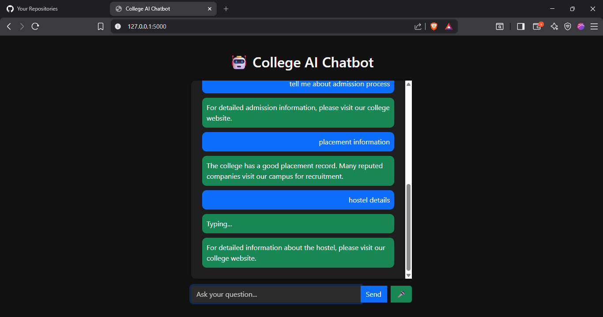
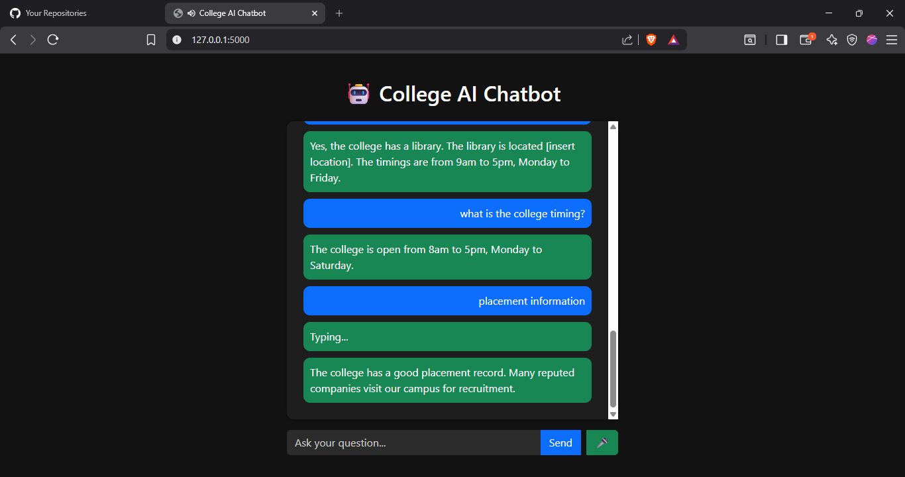

# 🤖 College AI Chatbot

An AI-powered chatbot developed using Machine Learning, NLP, Flask, and JavaScript to automate college-related student queries with voice assistant and modern UI support.

---

# 🚀 Features

- 🤖 NLP-based intelligent chatbot
- 🎤 Voice assistant support
- 🔊 Text-to-speech responses
- 🌙 Dark mode UI
- 💬 Chat history
- ⌨️ Enter key support
- ⚡ Real-time responses
- 🧠 Machine Learning intent prediction
- 📱 Responsive chatbot interface
- ✨ Typing animation

---

# 🛠 Technologies Used

## Backend
- Python
- Flask
- Scikit-learn
- NLP

## Frontend
- HTML
- CSS
- JavaScript
- Bootstrap

## Machine Learning
- TF-IDF Vectorizer
- Decision Tree Classifier

---

# 📂 Project Structure

```bash
College-AI-Chatbot/
│
├── app.py
│
├── dataset/
│   └── intents1.json
│
├── model/
│   ├── chatbot_model.pkl
│   └── vectorizer.pkl
│
├── templates/
│   └── index.html
│
├── screenshots/
│
└── README.md
```

---

# ⚙️ Installation

## Clone Repository

```bash
git clone https://github.com/yourusername/College-AI-Chatbot.git
```

---

## Open Project Folder

```bash
cd College-AI-Chatbot
```

---

## Install Dependencies

```bash
pip install flask
pip install nltk
pip install scikit-learn==1.2.1
pip install numpy==1.23.5
pip install scipy==1.10.1
```

---

# ▶️ Run Project

```bash
python app.py
```

---

# 🌐 Open in Browser

```bash
http://127.0.0.1:5000
```

---

# 🧠 Chatbot Workflow

```text
User Input
   ↓
Text Preprocessing
   ↓
TF-IDF Vectorization
   ↓
Machine Learning Prediction
   ↓
Intent Detection
   ↓
Bot Response
```

---

# 🎤 Voice Assistant Features

- Speech-to-text input
- Text-to-speech output
- Real-time voice interaction

---

# 🌙 UI Features

- Modern dark mode design
- Responsive layout
- Animated chatbot messages
- Smooth user experience

---

# 📌 Future Improvements

- LSTM Deep Learning chatbot
- Database integration
- User authentication
- Streamlit deployment
- Cloud deployment
- Multi-language support

---

# 📸 Screenshots




---

# 👨‍💻 Author

## Sairaj Bhandalkar

AI & Machine Learning Enthusiast  
Passionate about building intelligent real-time AI systems using Machine Learning, NLP, and Deep Learning.

---

# ⭐ GitHub

If you like this project, give it a ⭐ on GitHub.


