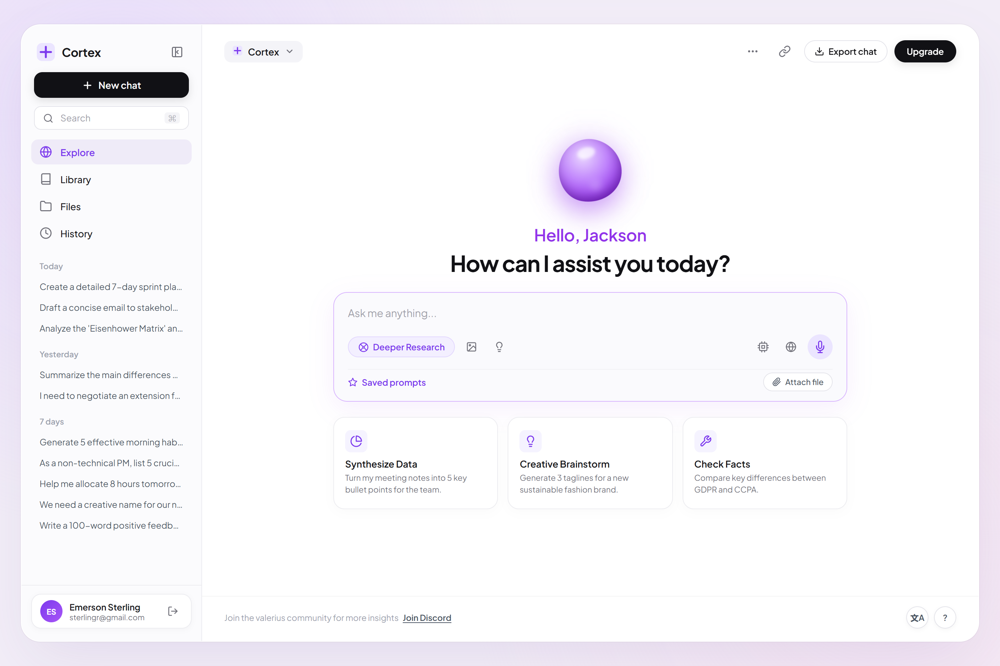
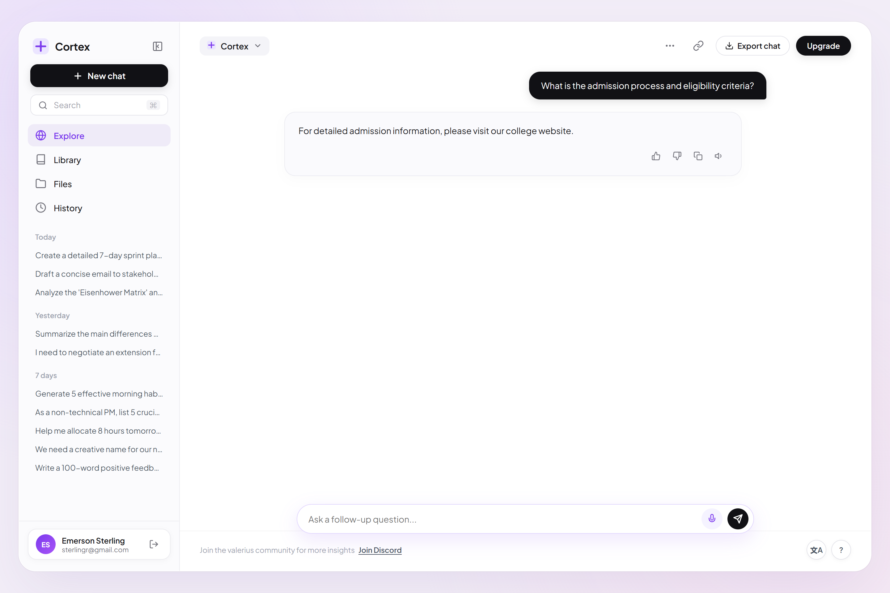
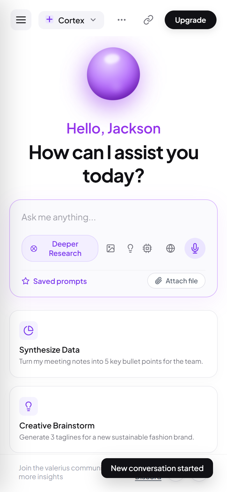

# College AI Chatbot

A premium campus AI assistant powered by a Scikit-Learn Machine Learning intent classification engine and Flask backend. Features the modern, minimalist **"Cortex" UI Design** (inspired by Kirill Soliar / SOLAR Digital) with an animated 3D liquid violet orb, quick action cards, and voice intelligence.

---

## 🌐 Live Public Link

The application is deployed and currently accessible live worldwide at:

👉 **[https://handled-favorites-aberdeen-mines.trycloudflare.com](https://handled-favorites-aberdeen-mines.trycloudflare.com)**

---

## Overview

College AI Chatbot is designed to guide students, applicants, and visitors through campus inquiries—ranging from admission eligibility, course programs, and fee structures to hostel accommodation, placements, and campus facilities.

The user interface delivers a modern SaaS aesthetic featuring:
- Soft lavender ambient backdrop (`#F2EDF7`) with pastel radial glows.
- Floating rounded desktop window container (`border-radius: 28px`).
- Animated 3D liquid violet centerpiece orb with specular highlights and fluid physics.
- Quick action cards (**Synthesize Data**, **Creative Brainstorm**, **Check Facts**) mapped to college queries.
- Voice intelligence with real-time Speech-to-Text dictation and Text-to-Speech audio readouts.
- Responsive design tailored for desktop, tablet, and mobile browsers.

---

## Features

- **3D Liquid AI Core**: Centerpiece orb featuring multi-stop radial gradients, fluid keyframe morphing (`liquidMorph`), and rhythmic floating physics (`orbFloat`).
- **Interactive Quick Action Cards**: One-click prompt cards for quick inquiries on admissions, academics, and college facilities.
- **Voice Intelligence**:
  - **Speech-to-Text (STT)**: Real-time microphone dictation via Web Speech API with pulsating recording animation.
  - **Text-to-Speech (TTS)**: Instant natural voice readout for AI replies with one-click replay.
- **Session & History Persistence**: Automatic LocalStorage synchronization, categorized history (`Today`, `Yesterday`, `7 days`), search filtering, and one-click export chat (`.txt`).
- **Safe DOM Rendering (XSS Immune)**: Sanitized message nodes preventing script injection.
- **Cross-Platform Responsive**: Fluid adaptation across desktop and mobile screens with slide-out navigation drawer.

---

## Tech Stack

### Backend
- **Python 3.10 / 3.11**
- **Flask**: Lightweight web framework and JSON REST API
- **Gunicorn**: Production WSGI HTTP server
- **Scikit-learn (v1.2.1)**: Trained Decision Tree Intent Classifier
- **NumPy (1.26.4)**: Array operations
- **Pickle**: Serialized ML model and TF-IDF feature extractor

### Frontend
- **Semantic HTML5**
- **Modern CSS3**: Custom properties, glassmorphism, fluid keyframe animations
- **Vanilla JavaScript (ES6+)**: Web Speech API, LocalStorage persistence, dynamic DOM engine

---

## AI/ML Architecture

```mermaid
flowchart LR
    User["User Query\n'What courses are offered?'"] --> Pre["Input Preprocessing\n(strip, lowercase)"]
    Pre --> TFIDF["TF-IDF Vectorizer\n(model/vectorizer.pkl)"]
    TFIDF --> DT["Decision Tree Classifier\n(model/chatbot_model.pkl)"]
    DT --> Tag["Predicted Intent Tag\n('courses')"]
    Tag --> Dataset["Dataset Lookup\n(dataset/intents1.json)"]
    Dataset --> Resp["Selected Campus Response"]
    Resp --> API["JSON Output\n{'response': '...'}"]
```



1. **Feature Extraction**: Incoming user text is converted into numerical feature vectors using a pre-trained `TfidfVectorizer`.
2. **Intent Classification**: A trained `DecisionTreeClassifier` maps the vector into one of several predefined campus intent tags (e.g., `admission`, `courses`, `fees`, `hostel`, `placement`, `timings`).
3. **Response Selection**: The predicted tag selects a randomized, high-quality answer from `dataset/intents1.json`.

---

## Project Structure

```text
college-ai-chatbot/
├── app.py                      # Production Flask application & API routes
├── requirements.txt            # Python dependencies (Flask, Gunicorn, Scikit-learn, NumPy)
├── render.yaml                 # Render Blueprint deployment configuration
├── Procfile                    # Web process command for cloud PaaS
├── .python-version             # Python version specification
├── .env.example                # Environment variables template
├── .gitignore                  # Git ignore rules
├── README.md                   # Documentation
│
├── dataset/
│   └── intents1.json           # Campus topics, query patterns, and responses
│
├── model/
│   ├── chatbot_model.pkl       # Trained Scikit-Learn intent model
│   └── vectorizer.pkl          # Pickled TF-IDF vectorizer
│
├── templates/
│   └── index.html              # Cortex AI interface layout
│
├── static/
│   ├── styles.css              # Cortex design system & styling
│   └── app.js                  # Interaction engine, voice/chat logic
│
└── screenshots/                # Application preview captures
    ├── cortex_desktop_landing.png
    ├── cortex_conversation_active.png
    └── cortex_mobile_landing.png
```

---

## Installation & Setup

### Prerequisites
- Python 3.10 or 3.11 installed
- Git installed

### 1. Clone the Repository
```bash
git clone https://github.com/sairajbhandalkar61-ctrl/college-ai-chatbot.git
cd college-ai-chatbot
```

### 2. Create and Activate Virtual Environment
```bash
# Windows (PowerShell)
python -m venv venv
.\venv\Scripts\Activate.ps1

# macOS/Linux
python3 -m venv venv
source venv/bin/activate
```

### 3. Install Dependencies
```bash
pip install -r requirements.txt
```

---

## Local Development

Start the local Flask development server:
```bash
python app.py
```
Or run with Gunicorn (macOS/Linux):
```bash
gunicorn --bind 0.0.0.0:5000 app:app
```
Access the application at `http://127.0.0.1:5000`.

---

## API Specification

### 1. Chat Completion Endpoint
- **URL**: `/chat`
- **Method**: `POST`
- **Headers**: `Content-Type: application/json`

**Request Body**:
```json
{
  "message": "What courses are offered in the college?"
}
```

**Response Body**:
```json
{
  "response": "The college offers courses in Information Technology, Computer Engineering, Mechanical Engineering, Chemical Engineering, and Civil Engineering."
}
```

### 2. Health Probe
- **URL**: `/health`
- **Method**: `GET`

**Response Body**:
```json
{
  "service": "college-ai-chatbot",
  "status": "healthy"
}
```

---

## Deployment

### Deploy to Render

1. Push this repository to your GitHub account (`college-ai-chatbot`).
2. In [Render Dashboard](https://dashboard.render.com), click **New** &rarr; **Web Service**.
3. Connect your `college-ai-chatbot` GitHub repository.
4. Configure the service:
   - **Environment**: `Python`
   - **Build Command**: `pip install -r requirements.txt`
   - **Start Command**: `gunicorn app:app`
   - **Environment Variables**:
     - `PYTHON_VERSION`: `3.10.14`
     - `FLASK_ENV`: `production`
5. Click **Deploy Web Service** (or use the included `render.yaml` Blueprint).

---

## Screenshots

| Desktop Landing View | Active Conversation & ML Response |
|:---:|:---:|
|  |  |

| Mobile Responsive Layout |
|:---:|
|  |

---

## Future Improvements

- [ ] Fine-tuned campus LLM fallback for out-of-domain questions.
- [ ] Multilingual intent classification for regional student languages.
- [ ] Direct integration with student portals (grades, timetable, attendance).
- [ ] Interactive campus map viewer with building locator pins.
