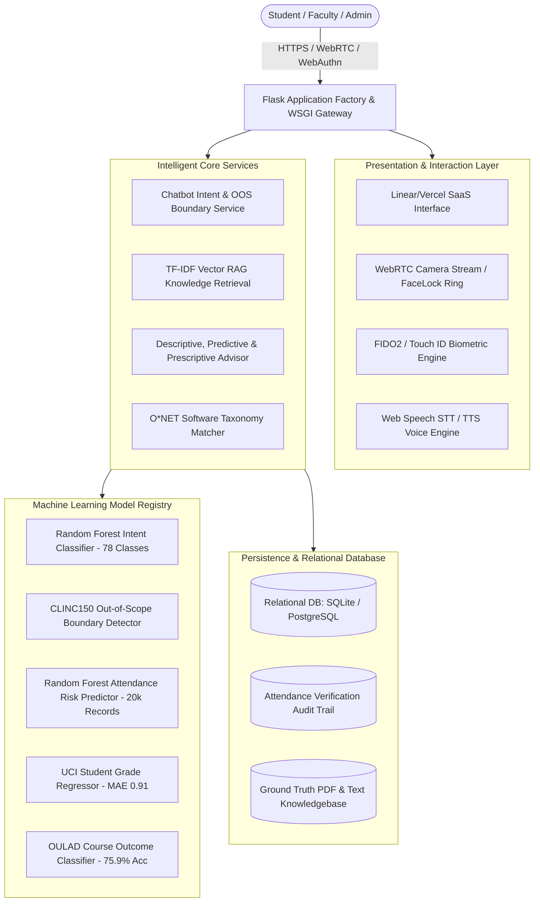

# CORTEX 2.0 • System Architecture Specification
## Intelligent AI-Powered Campus Management & Student Success Ecosystem

---

## 1. Executive Architectural Overview

CORTEX 2.0 transforms traditional isolated campus software into a unified, reactive intelligence ecosystem. Rather than a standalone rule-based chatbot or passive student dashboard, CORTEX 2.0 combines **hybrid NLP dialogue, grounded Retrieval-Augmented Generation (RAG), descriptive/predictive/prescriptive learning analytics, multimodal biometric attendance verification, and automated career competency alignment**.

---

## 2. Layered Architecture Breakdown

### 2.1 Presentation & Interaction Layer
- **Unified SaaS Dashboard (`templates/cortex2.html`)**: Inspired by Linear, Notion, and Vercel. Features a dark navy sidebar (`#0f172a`), responsive content layout, role switcher, real-time notifications drawer, and dark/light mode toggle.
- **120Hz Ambient Chatbot Mode (`templates/index.html`)**: Preserves the high-refresh rate ambient canvas UI with conversational history, voice dictation, speech synthesis, and quick action chips.
- **Biometric Station**:
  - **FaceLock AI**: Uses client-side WebRTC `navigator.mediaDevices.getUserMedia` video stream with laser scan overlays. Emits cryptographically tagged attendance tokens.
  - **Hardware WebAuthn**: Interfaces with `PublicKeyCredential` for native Windows Hello, Mac Touch ID, and mobile biometric sensors.

### 2.2 Blueprints & Route Architecture (15 Modular Blueprints)
1. `auth_bp` (`/api/auth`): Session-based authentication, user profile hydration, RBAC (Student, Faculty, Admin).
2. `chatbot_bp` (`/api/chatbot`): Hybrid dialogue manager combining 78 intent classifications, CLINC150 OOS detection, grounded RAG document matching, and live database queries.
3. `attendance_bp` (`/api/attendance`): Real-time biometric punching, attendance log query, and habit risk prediction.
4. `success_advisor_bp` (`/api/success`): Descriptive student metrics, predictive risk scores, prescriptive "Next Best Action" prioritizer, and interactive study plan checklists.
5. `academic_bp` (`/api/academic`): Semester results, UCI performance predictions ($G_3$ score), and OULAD completion likelihood.
6. `career_bp` (`/api/career`): Resume NLP skill extractor, O*NET software skills taxonomy matching, and skill gap recommendations.
7. `timetable_bp` (`/api/timetable`): Weekly lecture schedule and examination timetable.
8. `assignments_bp` (`/api/assignments`): Active assignments, submissions, and grading.
9. `notices_bp` (`/api/notices`): Campus bulletins with automated AI summaries.
10. `grievances_bp` (`/api/grievances`): Confidential student grievance submission, automatic categorization, and resolution tracking.
11. `notifications_bp` (`/api/notifications`): Priority alerts (attendance warnings, examination dates, assignment due dates).
12. `students_bp` (`/api/students`): Student profile dashboard and achievement badges.
13. `faculty_bp` (`/api/faculty`): Faculty course roster, lecture attendance session creation, and grade entry.
14. `admin_bp` (`/api/admin`): Institutional overview, student/faculty directories, and system health checks.
15. `rag_bp` (`/api/rag`): Institutional document upload, chunking, and grounded TF-IDF vector retrieval.

---

## 3. Database Schema Overview

The database is built on SQLAlchemy ORM supporting both PostgreSQL (Production) and SQLite (Development/Local Fallback):
- `users`: Core identity, password hashing (scrypt/PBKDF2), and roles.
- `student_profiles`: Academic metadata, CGPA, cumulative attendance rate, department, batch.
- `faculty_profiles`: Department, designation, room number, assigned classes.
- `departments`, `courses`, `subjects`, `enrollments`: Hierarchical academic relationships.
- `attendance_sessions` & `attendance_records`: Audited session logs with verification methods (`FaceLock AI`, `Fingerprint Sensor`, `Manual`).
- `academic_results`: Course examination scores, maximum marks, and grades.
- `assignments` & `assignment_submissions`: Continuous assessment tracking.
- `timetable` & `examinations`: Scheduled lecture slots and examination dates.
- `notices`: Official announcements with categories, audience targeting, and pin priority.
- `grievance_tickets`: Tracking numbers (`GRV-2026-XXXX`), priority, category, and resolution status.
- `notifications`: User-directed notifications with read/unread status.
- `career_profiles`: Extracted skills, target roles, and O*NET matches.
- `study_recommendations`, `study_plans`, `study_plan_tasks`: Personalized student learning companion data.
