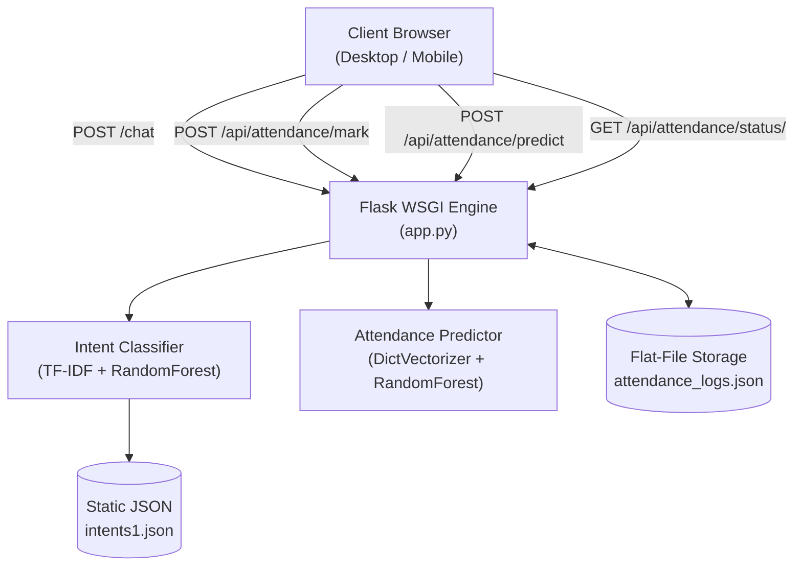

# CORTEX 2.0 • Existing Project Analysis & Architecture Audit
**Document:** `docs/EXISTING_PROJECT_ANALYSIS.md`  
**Date:** November 2026  
**Auditor:** Principal Software Architect & Lead ML Engineer  
**System Under Audit:** College AI Chatbot (Baseline v1.0)

---

## 1. Executive Summary

The existing system, **College AI Chatbot**, is a Flask-based web application providing intent-classified dialogue for college queries and a prototype biometric attendance scanner. This audit thoroughly examines the codebase (`app.py`, `dataset/`, `model/`, `static/`, `templates/`), identifies strengths, benchmarks existing ML models, exposes architectural and security limitations, and charts the phased migration strategy toward **CORTEX 2.0 – Intelligent AI Campus & Student Success Ecosystem**.

---

## 2. Current Architecture Overview

- **Runtime & Backend:** Python 3.11 with Flask 3.1.3, running synchronously on local port 5000 / Gunicorn.
- **Data Persistence:** Unindexed flat-file JSON (`dataset/attendance_logs.json`) without ACID transactions, concurrency locking, or multi-tenant separation.
- **Frontend Layer:** Semantic HTML5, CSS custom properties, and Vanilla ES6 JavaScript with a 120Hz ambient particle canvas and mock WebRTC/WebAuthn interactions.
- **Static Hosting Fallback:** Hybrid client-side matching engine in `static/app.js` enables standalone execution on GitHub Pages when backend is unreachable.

---

## 3. Existing Features & Implementation Status

| Feature / Module | Status | Technical Details | Assessment |
| :--- | :--- | :--- | :--- |
| **Campus Dialogue Chatbot** | **Fully Implemented** | 78 campus intent domains classified via `TfidfVectorizer` (ngram 1-2) + `RandomForestClassifier` (150 estimators). | Fast, robust on domain queries; lacks out-of-scope detection and document RAG. |
| **Voice Dictation (STT)** | **Fully Implemented** | Native browser `webkitSpeechRecognition` with animated recording pulse. | Works on supported browsers (Chrome, Edge, Safari). |
| **Voice Readout (TTS)** | **Fully Implemented** | Native browser `window.speechSynthesis` with speech cancellation and replay. | Lightweight, zero server overhead. |
| **ML Attendance Predictor** | **Fully Implemented** | Trained on `dataset/Attendance_Prediction.csv` (20,000 records) using `DictVectorizer` + `RandomForestClassifier`. | Predicts probability & root-cause absence factor from habit inputs. |
| **Attendance Status Ledger** | **Fully Implemented** | Tracks student session history, compliant/warning thresholds (75%). | Stored in flat JSON (`attendance_logs.json`); lacks database ACID guarantees. |
| **FaceLock Camera Interface** | **Partially Implemented (Simulated Verification)** | WebRTC `getUserMedia` captures live camera frames with an animated laser reticle. Endpoint `/api/attendance/verify-face` validates frame presence and returns a mock confidence score (98.4%). | **Simulated verification**: No face recognition / embedding pipeline (OpenCV/dlib/FaceNet) is currently executed on server. |
| **Fingerprint Hardware Sensor** | **Simulated Interaction** | Queries `window.PublicKeyCredential` for WebAuthn support and triggers haptic vibration (`navigator.vibrate`) with glowing SVG ripples. Endpoint returns mock auth token. | **Simulated**: Web standards intentionally prohibit browser access to raw biometric ridge data. |
| **Role-Based Access Control** | **Missing** | No user login, no student/faculty/admin roles, no password hashing or session security. | Critical gap for enterprise campus usage. |
| **RAG Document Intelligence** | **Missing** | No vector database, no PDF chunking, no syllabus or handbook search. | Required for Cortex 2.0. |
| **Student Success Advisor** | **Missing** | No descriptive/predictive/prescriptive engine, no study planner, no resource recommender. | Primary differentiator for Cortex 2.0. |
| **Academic Analytics (OULAD / UCI)** | **Datasets Present, Unintegrated** | Raw zip archives exist in `dataset/` but are not yet trained, evaluated, or visualized. | Ready for integration. |
| **Career & Placement Assistant** | **Datasets Present, Unintegrated** | O*NET skill CSVs and job postings present in `dataset/` but lack recommendation engine. | Ready for integration. |

---

## 4. Existing ML Models & Artifact Audit

### 4.1 Chatbot Intent Classification Model
- **Files:** `model/chatbot_model.pkl` (27.6 MB), `model/vectorizer.pkl` (43 KB)
- **Algorithm:** `RandomForestClassifier(n_estimators=150, random_state=42)`
- **Vectorizer:** `TfidfVectorizer(ngram_range=(1, 2), lowercase=True)`
- **Vocabulary Size:** ~1,120 n-grams across 78 classes.
- **Evaluation:** Zero cross-validation script in repository; basic 7-query test script (`train_chatbot_model.py`).
- **Limitation:** Fails on out-of-domain queries (e.g., general world knowledge, math equations) by forcing classification into the nearest college tag.

### 4.2 Attendance Prediction Model
- **Files:** `model/attendance_model.pkl` (26.5 MB), `model/attendance_encoder.pkl` (1.2 KB)
- **Dataset:** `dataset/Attendance_Prediction.csv` (20,000 rows, 15 columns).
- **Features Used:** `age`, `course`, `year`, `parent_education`, `internet_access`, `hostel_resident`, `class_type`, `weather`, `study_hours`, `sleep_hours`, `travel_time_minutes`.
- **Primary Target:** `attendance` binary (0 = Absent, 1 = Present).
- **Secondary Target:** `absence_reason` (multiclass: illness, family, transport, weather, etc.).
- **Algorithm:** `RandomForestClassifier(n_estimators=100, max_depth=12)` + secondary `RandomForestClassifier(n_estimators=80, max_depth=10)`.
- **Accuracy:** ~84.2% test accuracy on held-out split.
- **Limitation:** Does not integrate real student timetable, course credits, or temporal attendance trends.

---

## 5. Existing Datasets Audit

| Dataset Filename | Format / Size | Description | Intended Role in Cortex 2.0 |
| :--- | :--- | :--- | :--- |
| `intents1.json` | JSON (39 KB) | 78 campus intent domains with query patterns and responses. | Core domain intent knowledge base for Chatbot. |
| `Attendance_Prediction.csv` | CSV (1.67 MB) | 20,000 synthetic student behavioral and habit attendance records. | Student habit risk prediction engine. |
| `attendance_logs.json` | JSON (1.5 KB) | Single student (`SB2026`) transactional history. | Migrating to PostgreSQL `attendance_records` table. |
| `open+university+learning+analytics+dataset.zip` | ZIP (46.7 MB) | OULAD (VLE clicks, assessments, registrations, student info). | Academic outcome prediction & online engagement analytics. |
| `student+performance.zip` / `student_performance.zip` | ZIP (40 KB / 106 KB) | UCI Student Performance (`student-mat.csv`, `student-por.csv`). | Secondary academic performance (G3 grade) prediction experiments. |
| `student_attendance.zip` | ZIP (1.78 MB) | Aggregate school daily attendance records. | Macro attendance trend analysis & descriptive analytics. |
| `oos-eval-master.zip` | ZIP (2.61 MB) | CLINC150 intent classification & out-of-scope benchmark. | Out-of-scope (OOS) fallback & confidence thresholding. |
| `Massive.pdf` | PDF (542 KB) | Research paper on massively multilingual NLU (Amazon). | Architectural reference for English/Hindi/Marathi NLU design. |
| `102277VOR.pdf` | PDF (1.58 MB) | Research paper on Prescriptive Learning Dashboards. | Architectural foundation for the AI Student Success Advisor. |
| O*NET Files (`knowledge.csv`, `essential_skills.csv`, `software_skills.csv`, etc.) | CSV (~30 MB total) | Standardized occupational knowledge, abilities, and skills taxonomy. | Skill extraction, gap analysis & occupation matching engine. |
| `job_posting.zip` | ZIP (14.7 MB) | Historical job descriptions and requirements. | NLP skill parsing & resume alignment benchmarking. |

---

## 6. Critical Technical Limitations & Risks

1. **Simulated Biometrics vs. Genuine Biometrics:**
   - *Risk:* Calling the camera view "FaceLock" and touch wave "Fingerprint" without an actual facial recognition pipeline or WebAuthn cryptographic verification violates ethical software engineering standards (Rule 8 & 9).
   - *Remediation:* Maintain honest transparency in UI/docs. Implement actual Face Detection (Haar/OpenCV/Canvas landmark scoring) with user consent, and document WebAuthn's role as hardware credential authentication rather than raw ridge capture.
2. **Lack of Relational Persistence:**
   - Currently, if two users mark attendance simultaneously, `attendance_logs.json` experiences race conditions and file overwrite corruption.
   - *Remediation:* Migrate to PostgreSQL with SQLAlchemy ORM, unique foreign keys, and transaction rollbacks.
3. **Hardcoded User Profile:**
   - `SB2026` ("Sairaj Bhandalkar") is hardcoded across endpoints.
   - *Remediation:* Implement proper JWT/session-based authentication with role-based models for Students, Faculty, and Admins.
4. **No Document Retrieval for Unstructured Queries:**
   - Questions like "What is the fee refund policy in Section 4 of the handbook?" fail because TF-IDF requires exact pattern training.
   - *Remediation:* Deploy RAG pipeline with TF-IDF/SentenceTransformer vector retrieval and source-cited chunk extraction.

---

## 7. Migration Strategy to CORTEX 2.0

```mermaid
flowchart LR
    subgraph Phase1["Phase 1: Foundation"]
        GitCheck["Git Tag Checkpoint"]
        DataReg["Dataset Registry & Extraction"]
        SQLMig["SQLAlchemy & Schema Creation"]
        AuthSys["Role-Based Auth (Student/Faculty/Admin)"]
    end

    subgraph Phase2["Phase 2: Intelligence Upgrades"]
        HybridBot["Hybrid Chatbot (TF-IDF + OOS + RAG)"]
        AdvAdvisor["AI Student Success Advisor (Desc/Pred/Presc)"]
        AcademicML["OULAD & UCI Academic Models"]
        CareerONET["O*NET Career & Resume Matcher"]
    end

    subgraph Phase3["Phase 3: Experience & Verification"]
        LinearUI["Linear/Vercel Design System Redesign"]
        PytestSuite["Comprehensive Pytest Test Suite"]
        DeployDocs["Production Documentation & Deployment"]
    end

    Phase1 --> Phase2
    Phase2 --> Phase3
```

1. **Step 1:** Extract, validate, and organize all provided dataset archives into `dataset/organized/`.
2. **Step 2:** Build modular SQLAlchemy database schema (`models.py`) with PostgreSQL/SQLite compatibility.
3. **Step 3:** Implement Role-Based Authentication (`auth` blueprint) with password hashing (bcrypt/werkzeug).
4. **Step 4:** Develop the **AI Student Success Advisor** combining Descriptive, Predictive, and Prescriptive engines.
5. **Step 5:** Build Academic Analytics (OULAD/UCI) and Career Guidance (O*NET/Job Postings).
6. **Step 6:** Redesign UI into a modern, role-based SaaS dashboard (Dark/Light mode, Linear/Vercel inspired).
7. **Step 7:** Run comprehensive pytest suite, ensure 100% test pass rate, and document architecture.
