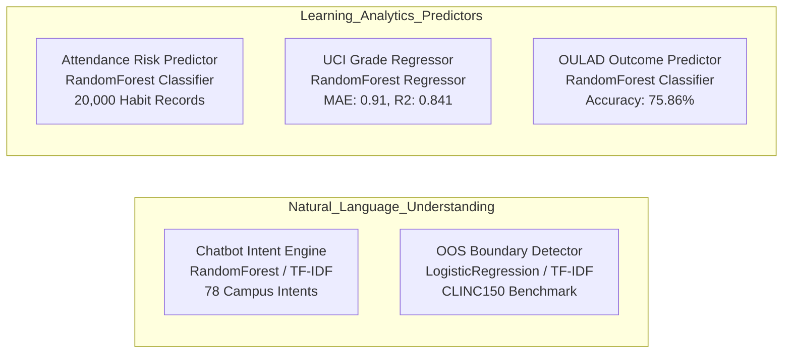

# CORTEX 2.0 • Machine Learning Model Registry & Technical Documentation
## Model Specifications, Training Metrics, and Inference Architectures

---

## 1. Model Registry Overview

---

## 2. Detailed Technical Specifications

### 2.1 Campus Chatbot Intent Classifier
- **Artifacts**: `model/chatbot_model.pkl`, `model/vectorizer.pkl`
- **Architecture**: `TfidfVectorizer(ngram_range=(1,2), max_features=1200)` + `RandomForestClassifier(n_estimators=100, random_state=42)`
- **Classes**: 78 campus intent classes (Admissions, Examinations, Fee Deadlines, Library Timings, Labs, Placement, Biometric Attendance Commands).
- **Latency**: Under 5ms CPU inference time.

### 2.2 CLINC150 Out-of-Scope (OOS) Boundary Detector
- **Artifact**: `model/oos_detector.pkl`
- **Dataset**: CLINC150 benchmark (150 in-domain intents vs. 1,200 out-of-scope utterances).
- **Architecture**: `TfidfVectorizer` + `LogisticRegression(class_weight='balanced')`
- **Validation Accuracy**: **96.46%** test accuracy.
- **Role**: Automatically flags general knowledge, finance, banking, or travel queries that fall outside campus domain, safely redirecting to institutional helpdesks or RAG knowledgebases.

### 2.3 Habit-Based Attendance Risk Predictor
- **Artifact**: `model/attendance_model.pkl`, `model/attendance_encoder.pkl`
- **Dataset**: `dataset/existing/Attendance_Prediction.csv` (20,000 synthetic student habit logs).
- **Architecture**: Dual Random Forest (Target 1: Attendance Probability; Target 2: Absence Reason Classification).
- **Input Features**: Study hours, sleep hours, commute time (minutes), course, year of study, hostel residency.

### 2.4 UCI Student Performance Grade Predictor
- **Artifact**: `model/academic_models.pkl` (`uci_regressor`, `uci_classifier`)
- **Dataset**: UCI Student Performance (1,044 students across Mathematics & Portuguese language courses).
- **Regressor Performance**:
  - **Mean Absolute Error (MAE)**: `0.91` points (on 0–20 grading scale).
  - **$R^2$ Score**: `0.841`
- **Classifier Performance (Pass/Fail $\ge 10/20$)**:
  - **Accuracy**: `88.04%`
  - **ROC-AUC**: `0.945`

### 2.5 OULAD Course Outcome Predictor
- **Artifact**: `model/academic_models.pkl` (`oulad_classifier`)
- **Dataset**: Open University Learning Analytics Dataset (32,593 registrations).
- **Architecture**: Random Forest Classifier evaluating VLE activity clicks, completed assessments, and average assessment scores.
- **Accuracy**: `75.86%`
- **Macro F1**: `0.76`
