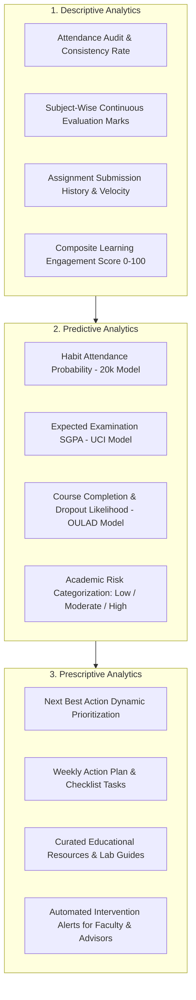

# CORTEX 2.0 • AI Student Success Advisor
## Descriptive, Predictive, and Prescriptive Learning Analytics Engine

---

## 1. Theoretical Foundation

The CORTEX 2.0 Student Success Advisor is architected around the empirical methodologies outlined in academic learning analytics literature (e.g. *Learning analytics and educational data mining in higher education*, ScienceDirect Ref: `102277VOR.pdf`).

Rather than displaying static historical charts, the advisor implements a continuous 3-stage intelligence loop:

---

## 2. The Three Analytic Pillars

### Pillar 1: Descriptive Analytics
Evaluates historical and current semester engagement:
- **Attendance Compliance**: Compares verified attendance rates against the mandatory 75% institutional debarment threshold.
- **Subject Mastery**: Evaluates marks relative to maximum attainable scores across Midterm, Internal, and Lab assessments.
- **Learning Engagement Score ($E$)**:
  $$E = 0.40 \cdot \text{Attendance} + 0.40 \cdot \text{Mean Score \%} + 0.20 \cdot \min(100, \text{Avg Assignment Marks} \cdot 2)$$

### Pillar 2: Predictive Analytics
Forecasts near-future academic outcomes:
- Evaluates sleep, commute time, and self-study habits via the 20,000-record RandomForest model.
- Predicts end-semester grade ($G_3$) using the UCI regression model with `MAE = 0.91`.
- Categorizes student risk into:
  - **Low Risk (Compliant)**: Probability $\ge 75\%$, high completion confidence.
  - **Moderate Risk**: Probability between $60\%$ and $75\%$, early warnings dispatched.
  - **High Debarment Risk**: Probability $< 60\%$, automatically activates advisor intervention.

### Pillar 3: Prescriptive Analytics & "Next Best Action"
Transforms predictions into prioritized, bite-sized tasks:
- **Next Best Action**: Automatically calculates the single most impactful activity the student can perform today (e.g., submit pending lab notebook, review neural network backpropagation, schedule attendance recovery).
- **Weekly Study Checklist**: Provides actionable daily goals with estimated completion times and status tracking.
- **Curated Resources**: Matches low-scoring subjects to targeted video lectures, documentation, and practice problem sets.
